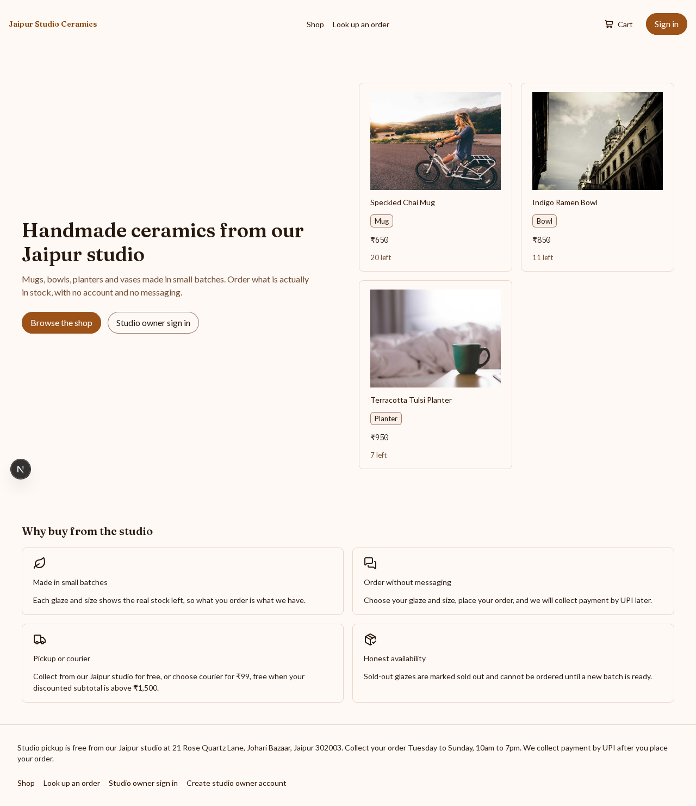
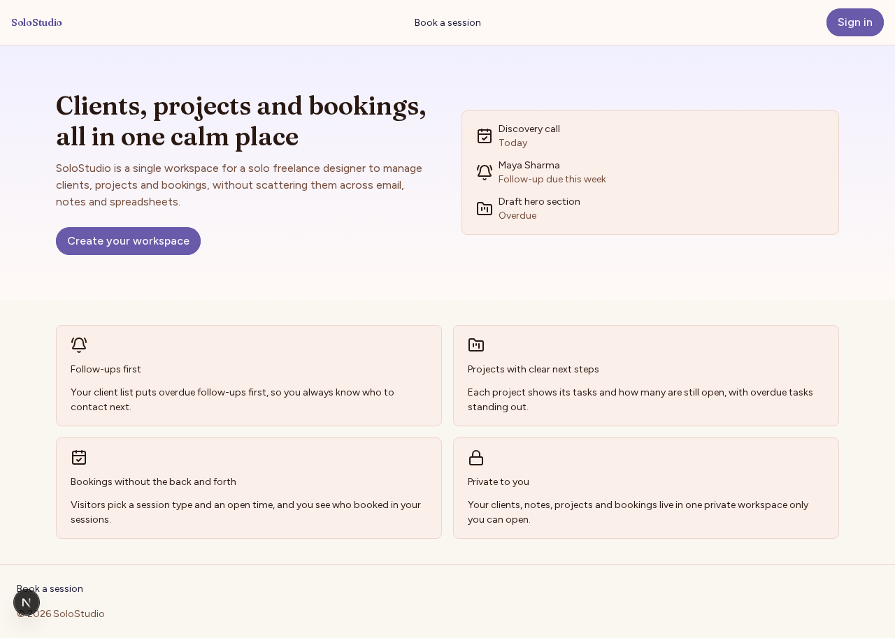
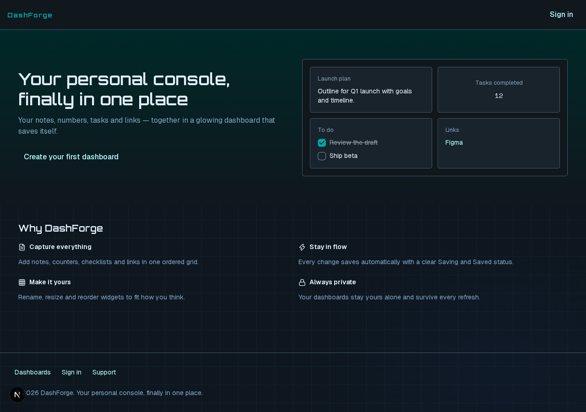

# Weave examples

Three apps that [Weave](https://github.com/avcs06/WeaveWithAI) generated, each from a short prompt. Weave turns an idea into user flows, a design, a data contract and then the code, with Meta's Muse models. Each folder holds the generated app and a README with its prompt, its numbers and a screenshot of every screen.

|  | [Jaipur Studio Ceramics](jaipur-studio-ceramics) | [SoloStudio](solostudio) | [DashForge](dashforge) |
|---|---|---|---|
| The app | A shop for a ceramics studio | A workspace for a freelance designer | Personal dashboards of widgets |
| Model | Muse Spark 1.3 on the Meta Model API | Muse Spark 1.3 on the Meta Model API | Muse Spark Open, open weights on Baseten |
| Coding agent | Muse Code | Muse Code | OpenCode |
| End-to-end time | 2 h 20 min | 1 h 40 min | 56 min |
| Total cost | $4.39 | $6.62 | $8.60 |
| Muse Code subscription | 4% of the weekly allowance | 5% of the weekly allowance | Not used |
| Screens measured | 18 | 14 | 4 |
| Issues raised | 37 | 53 | 129 |
| Issues fixed | 33 | 41 | 101 |
| AI discussion threads | 0 | 1 | 3 |
| Accessibility violations (axe, WCAG 2.2 AA) | 0 | 0 | 0 |
| Contrast failures | 0 | 0 | 0 |
| Controls without a name | 0 | 0 | 0 |
| Keyboard: controls reachable with Tab | 99.6% of 233 | 97.8% of 184 | 100% of 51 |
| Keyboard: focus visible | 87.9% | 98.3% | 92.2% |
| Type and lint errors | 0 | 0 | 0 |
| Design-system validation errors | 0 | 0 | 0 |
| Duplicated code | 2.1% | 5.8% | 3.8% |
| Code size | 110 files, 7,606 lines | 139 files, 8,380 lines | 88 files, 3,905 lines |

Accessibility and keyboard numbers are from the app's dev server (`next dev`), not a production build. The cost of the two Meta Model API apps covers the model calls; their coding sessions ran on the Muse Code subscription. Muse Wonder 1.0 wrote their scope. DashForge's time is scope to contract plus frames to pages.

## Home pages

### Jaipur Studio Ceramics

### SoloStudio

### DashForge

