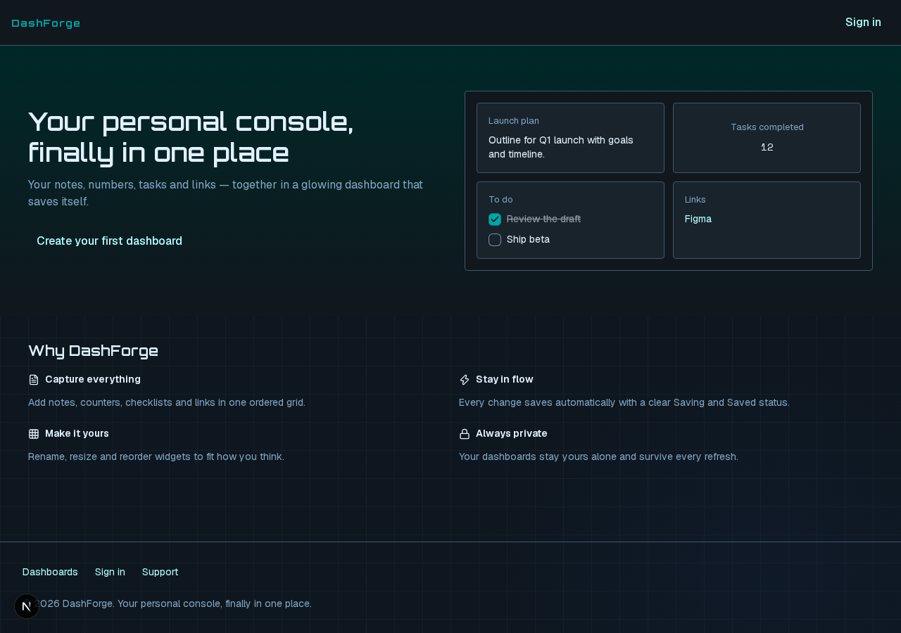
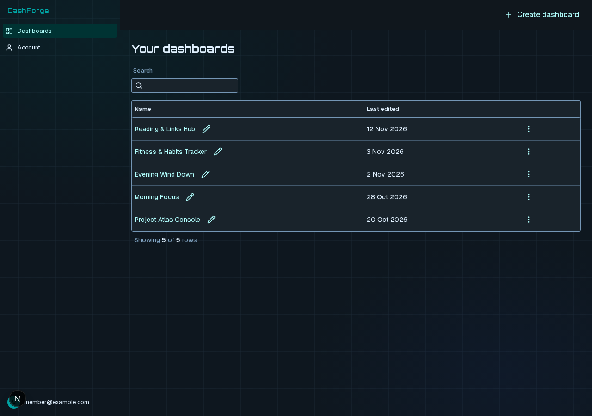
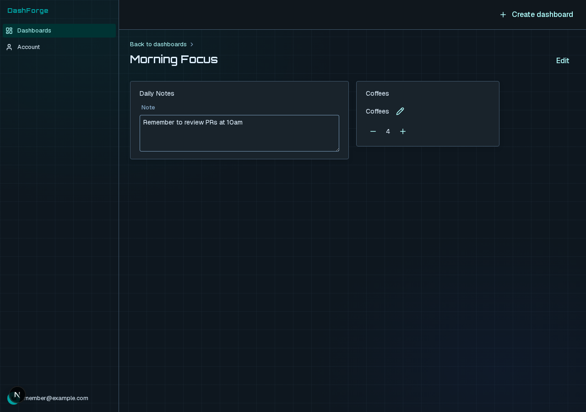
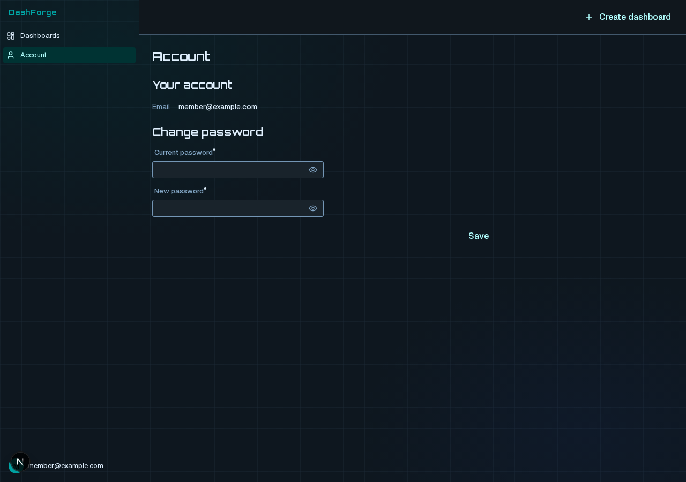

# DashForge

| | |
|---|---|
| Model | Muse Spark Open (`meta-models/muse-spark-open-1026`), open weights served on Baseten |
| Coding agent | OpenCode, on Muse Spark Open |
| End-to-end time | 56 min: scope to contract 13 min, frames to pages 43 min |
| Total cost | $8.60 on Baseten, the coding sessions included |
| Screens measured | 4 |
| Issues raised | 129 |
| Issues fixed | 101 |
| AI discussion threads Issues an agent kept open to discuss | 3 |
| Accessibility violations (axe, WCAG 2.2 AA) | 0 |
| Contrast failures | 0 |
| Controls without a name | 0 |
| Keyboard: controls reachable with Tab | 100% of 51 |
| Keyboard: focus visible | 92.2% |
| Type and lint errors | 0 |
| Design-system validation errors | 0 |
| Duplicated code | 3.8% |
| Code size | 88 files, 3,905 lines |

Accessibility and keyboard numbers are from the app's dev server (`next dev`), not a production build.

Weave generated this app from the prompt below.

## Prompt

People build personal dashboards. They click Create to start a new dashboard and
land in an editor. In the editor they add widgets:

- a note widget: plain text;
- a counter widget: a number with a label, which they can increase or decrease;
- a checklist widget: items they can tick off and add to;
- a link list widget: titles and web addresses.

After adding a widget they configure it: a title, and settings for its type. They
can rename a widget, change its position relative to the other widgets, resize it
between small, medium and large, and remove it. Where widgets sit on screen is up
to the design.

Dashboards have a name and can be renamed, duplicated and deleted. A list shows all
of a user's dashboards with when each was last edited. The editor saves changes
automatically.

It should look like it comes from the future: a dark, screen-like interface that
glows. Neon light picks out the controls, the edges and the numbers, the way a
spaceship console or a hacker's terminal does, with computer type for figures and
a faint grid behind the widgets. It can be bold and a little theatrical, as long
as every widget stays easy to read and use.

## Screenshots

Each screen at 1280px wide, with the app's seed data. Every screen but the
landing page is signed in.

### Landing page

`/`

### Your dashboards

`/dashboards`

### A dashboard

`/dashboards/dashboard-1`

### Account

`/account`

