# SoloStudio

| | |
|---|---|
| Model | Muse Spark 1.3 (`muse-spark-1.3`) on the Meta Model API, with Muse Wonder 1.0 (`muse-wonder-1.0`) for the scope |
| Coding agent | Muse Code, on Muse Spark 1.3 |
| End-to-end time | 1 h 40 min |
| Total cost | $6.62 for the model calls; the coding sessions ran on the Muse Code subscription |
| Muse Code subscription | 5% of the weekly allowance (28% to 33%) |
| Screens measured | 14 |
| Issues raised | 53 |
| Issues fixed | 41 |
| AI discussion threads | 1 |
| Accessibility violations (axe, WCAG 2.2 AA) | 0 |
| Contrast failures | 0 |
| Controls without a name | 0 |
| Keyboard: controls reachable with Tab | 97.8% of 184 |
| Keyboard: focus visible | 98.3% |
| Type and lint errors | 0 |
| Design-system validation errors | 0 |
| Duplicated code | 5.8% |
| Code size | 139 files, 8,380 lines |

Accessibility and keyboard numbers are from the app's dev server (`next dev`), not a production build.

Weave generated this app from the prompt below.

## Prompt

I'm a freelance UX designer. Clients live in my inbox, notes about them in
Apple Notes, project tasks in a spreadsheet, and discovery calls and my monthly
Figma workshop get booked over email back and forth. I want one app for all of
it, just for me.

Clients: name, email, company (optional), a short profile (what they do, how we
met, what they pay) and a status: Lead, Active, Past. Under each client I jot
dated notes after calls and set a follow-up date. The client list should show
who is due for a follow-up, overdue first, and I should be able to mark a
follow-up done or push it a week with one click.

Projects belong to a client: a name, a short description and an optional due
date. Each project has tasks with a title, a status (To do, In progress, Done),
a priority (Low, Medium, High) and an optional due date. I want to see all my
projects with how many tasks are still open, open a project to see its tasks,
filter by status and priority, search by title, and tick a task done quickly.
Overdue tasks should stand out. I can edit and delete clients, projects and
tasks; deleting a project deletes its tasks, and deleting a client deletes its
projects and notes.

Booking: I set my weekly availability (which days, from what time to what time)
and define session types: a 30 minute discovery call (free, one person), a 60
minute design review (₹4,000 shown for information, one person) and a 2 hour
Figma workshop (₹2,500 a seat, up to 8 people). Prices are only displayed,
nobody pays in the app. I see upcoming sessions and can cancel a slot, which
cancels everyone booked on it.

People booking don't have accounts. They open my public booking page, pick a
session type, see open slots for the next two weeks and book with their name
and email. A slot is full when it reaches the session type's maximum. If the
email matches one of my clients, the booking lands under that client; if not, a
new client is created as a Lead. After booking they see a cancellation link on
screen (no emails sent) and can use it to cancel.

My home screen: today's sessions, follow-ups due this week, overdue tasks.

Clean and calm, a bit like Linear but warmer.

## Screenshots

Each screen at 1280px wide, with the app's seed data. Every screen but the
landing page is signed in as the freelancer.

### Landing page

`/`

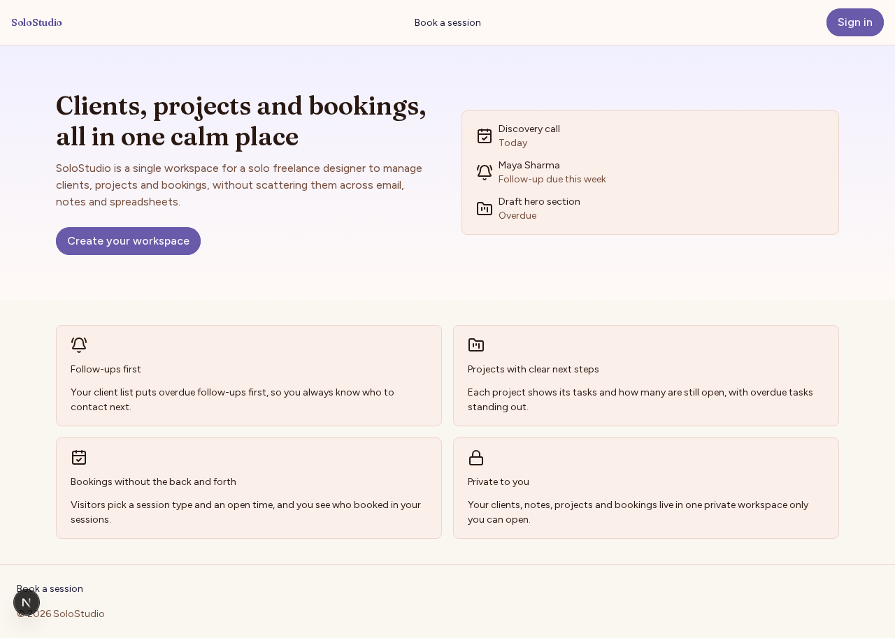

### Home

`/home`

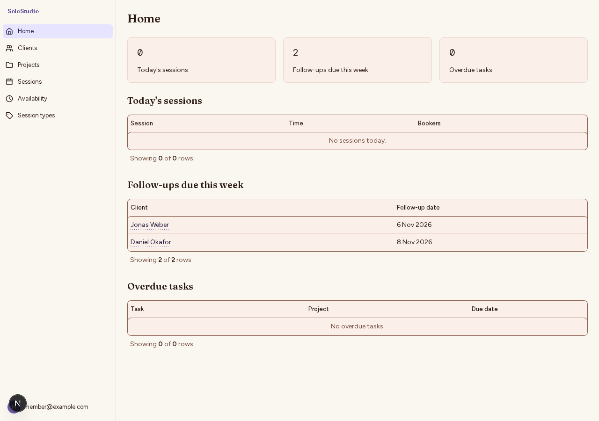

### Clients

`/clients`

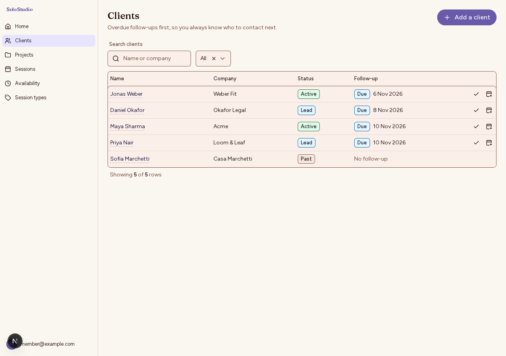

### A client

`/clients/client-1`

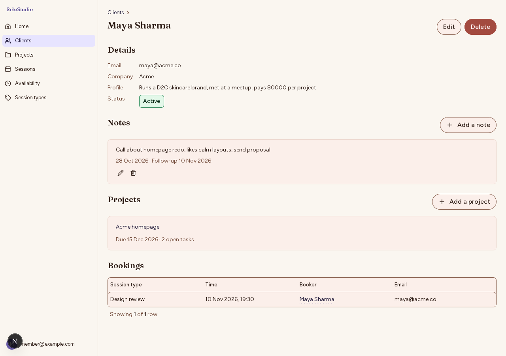

### Projects

`/projects`

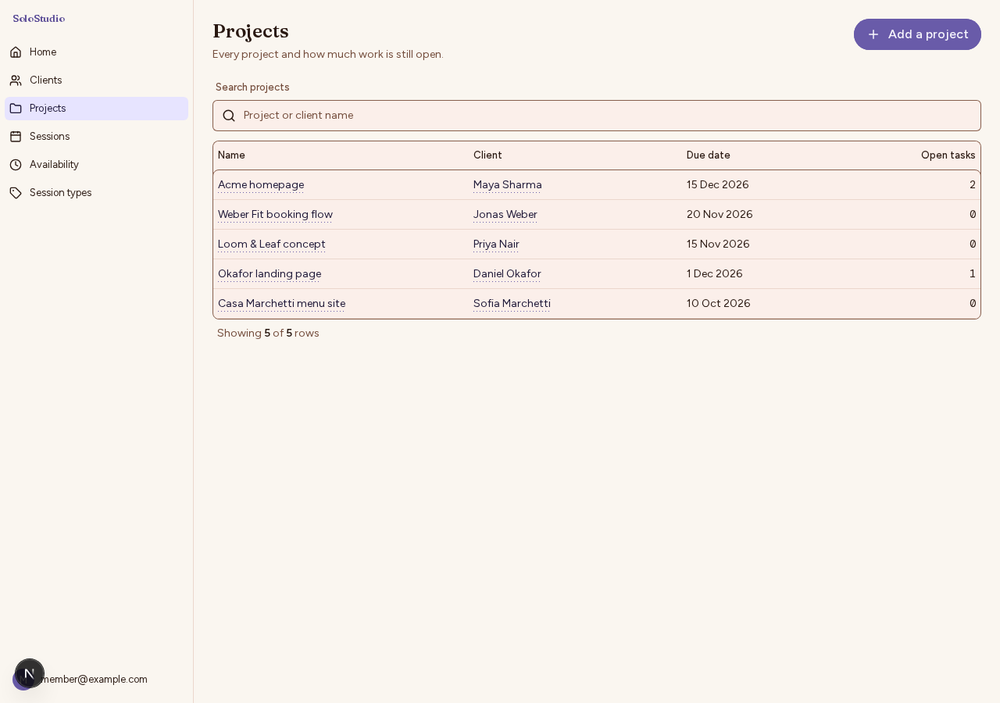

### A project

`/projects/project-1`

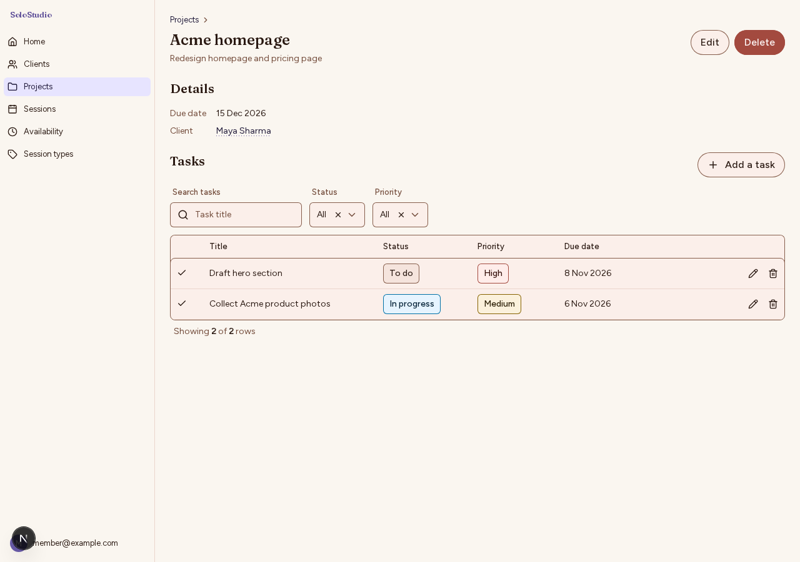

### Availability

`/availability`

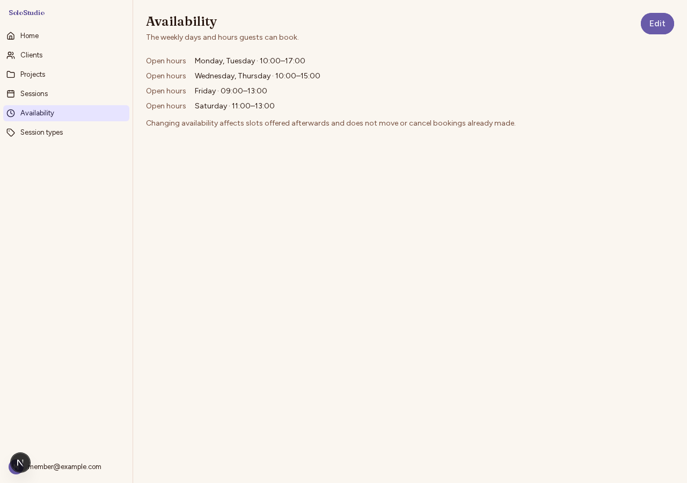

### Session types

`/session-types`

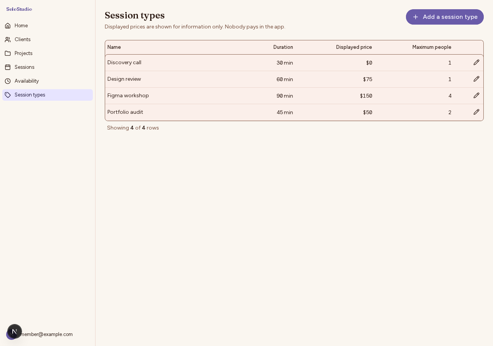

### Sessions

`/sessions`

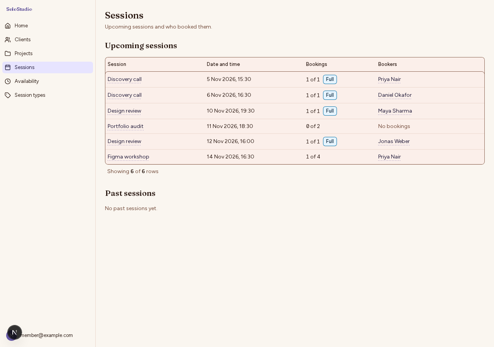

### A session slot

`/sessions/slot-1`

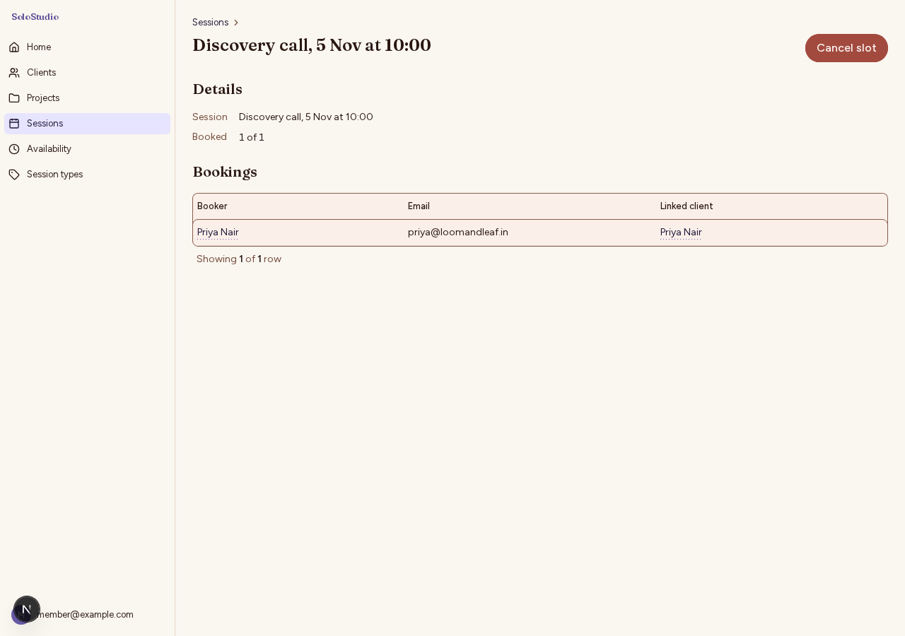

### A booking, for the freelancer

`/bookings/booking-1`

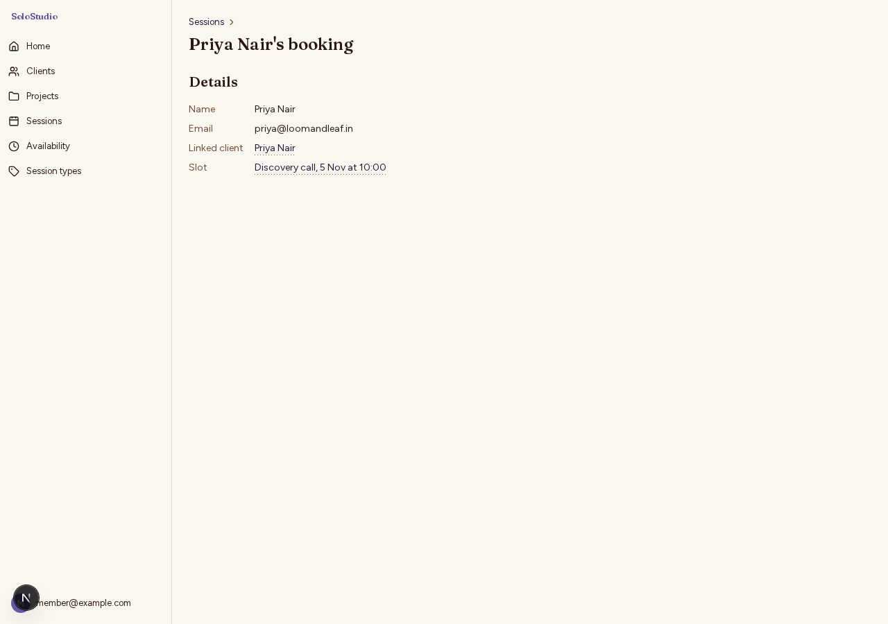

### Book a session

`/book`

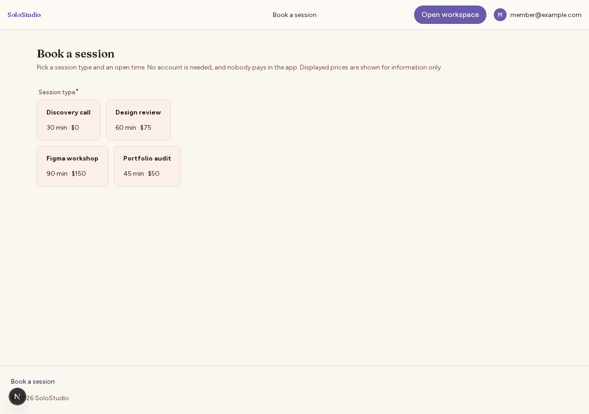

### A booking, for the person who booked

`/my-booking/booking-1`

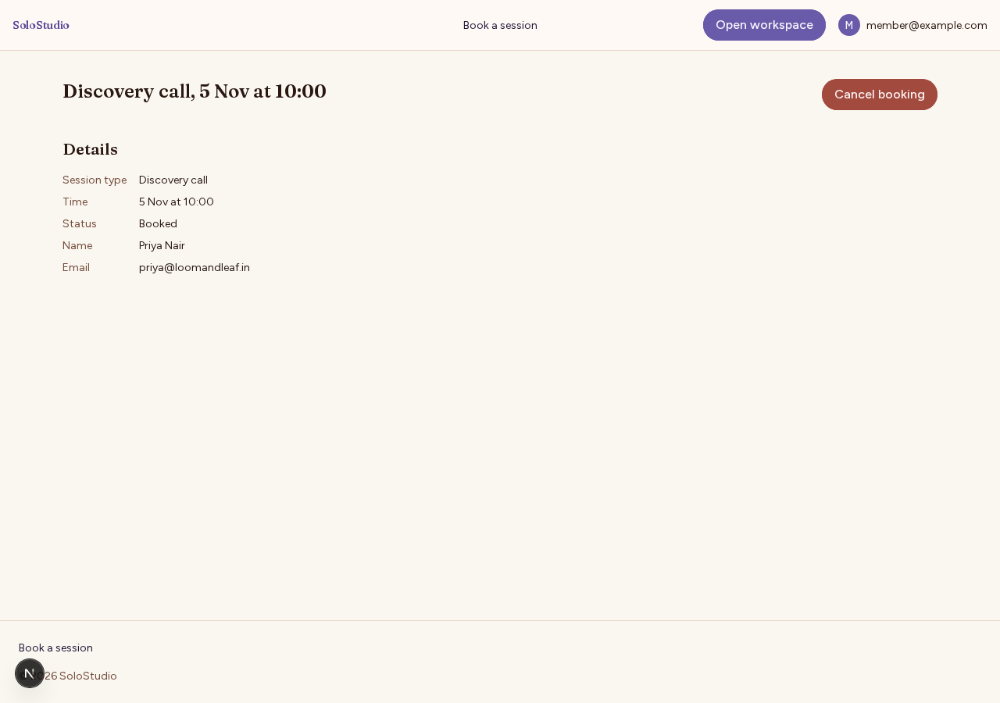

### Account settings

`/account`

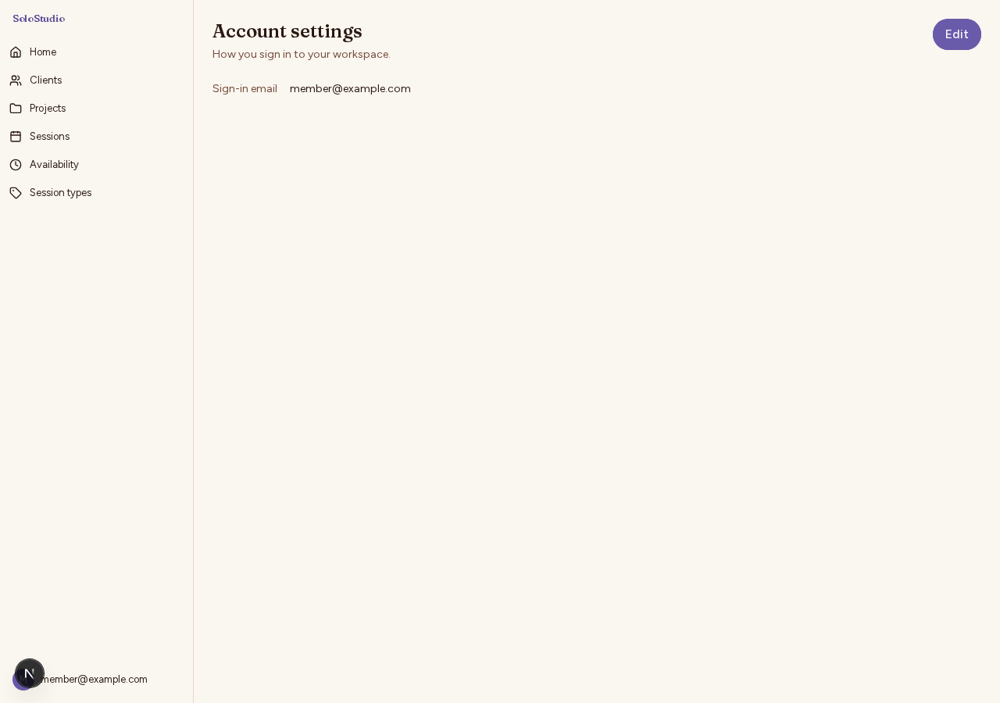
